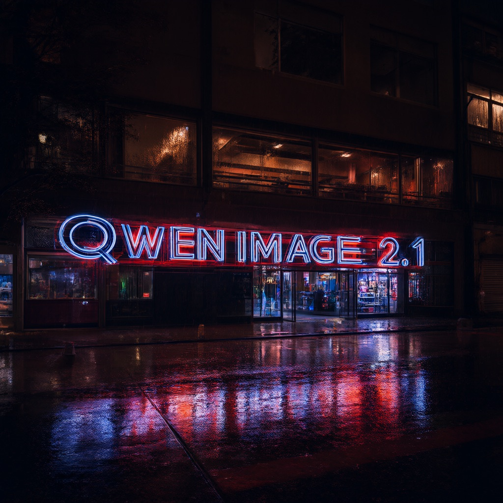
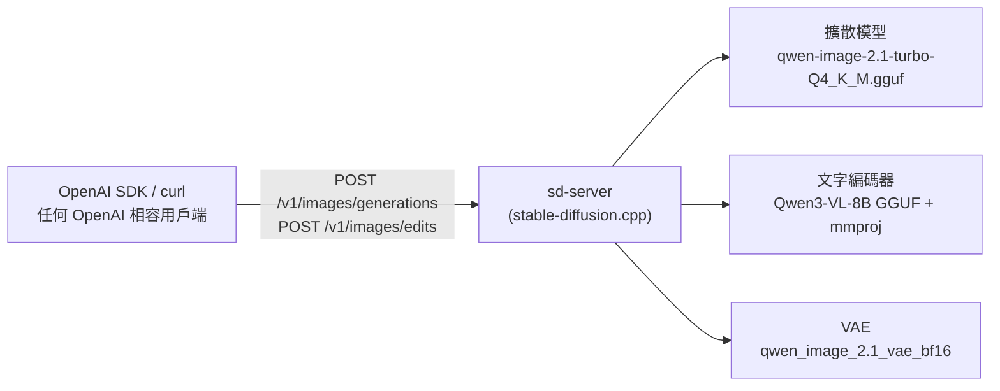

# Qwen-Image 2.1 GGUF × OpenAI 相容圖片 API

在本機以 [stable-diffusion.cpp](https://github.com/leejet/stable-diffusion.cpp) 的 `sd-server` 推論
[abenzerps/Qwen-Image-2.1-Turbo-Quantized](https://huggingface.co/abenzerps/Qwen-Image-2.1-Turbo-Quantized)，
提供與 OpenAI Images API 相容的 `/v1/images/generations` 與 `/v1/images/edits` 端點。
任何支援 OpenAI SDK 的程式，只要把 `base_url` 指向本機，就能直接使用 Qwen-Image 2.1 生成與編輯圖片。

> 模型來源已更名：原 `abenzerps/Qwen-Image-2.1-GGUF` 由作者更名（曾名 `Qwen-Image-2.1-Uncensored-GGUF`）為
> `abenzerps/Qwen-Image-2.1-Turbo-Quantized`，檔名改為 `qwen-image-2.1-turbo-<QUANT>.gguf`。
> 詳見[模型檔案](#模型檔案)。

## 範例

以下圖片皆由本專案更名前的預設組合（`Q4_K_M` + Qwen3-VL-8B `Q8_0`、20 步、CFG 1.0）透過 OpenAI 相容 API 產生。

| 文字生圖（1024x1024） | 圖片編輯：原圖 | 圖片編輯：結果 |
| --- | --- | --- |
|  |  |  |
| `A neon shop sign that reads "QWEN IMAGE 2.1", rainy night, reflections on wet pavement` | `a lovely cat holding a sign says hello` | `Change the text on the sign to 'Will 保哥'` |

## 特色

- **OpenAI 相容**：官方 `openai` Python / Node.js SDK、curl 或任何 OpenAI 相容用戶端皆可直接呼叫
- **文字生圖與圖片編輯**：支援單張或多張參考圖片編輯，以及中英文文字渲染
- **免編譯**：自動下載 sd.cpp 預先編譯版本（macOS Apple Silicon 內含 Metal 加速）
- **一行完成常用工作**：安裝、下載模型、驗證 SHA256、啟動／停止伺服器、生成圖片都有對應的 `make` 指令
- **可調整**：量化版本、文字編碼器、預設尺寸、步數、CFG 等都能以變數或 `.env` 覆寫
- **LoRA**：`.safetensors` LoRA 放在 `models/loras/` 後啟動自動載入目錄，生成時以 `--lora 檔名:權重` 指定

## 架構



## 系統需求

| 項目 | 需求 |
| --- | --- |
| 作業系統 | macOS（Apple Silicon）或 Linux x86_64；其他平台可用 `make build-sdcpp` 自行編譯 |
| 記憶體 | 預設組合約佔用 14 GB（擴散模型 4.1 GB + 文字編碼器 8.8 GB + VAE 0.6 GB），建議 32 GB 以上 |
| 硬碟空間 | 預設組合約 15 GB |
| 工具 | `make`、`curl`、`unzip`、`python3`、[uv](https://docs.astral.sh/uv/)、[hf](https://huggingface.co/docs/huggingface_hub/guides/cli)（沒有 `hf` 時會自動改用 `uvx`） |

## 快速開始

```bash
git clone https://github.com/doggy8088/Qwen-Image-2.1-GGUF.git
cd Qwen-Image-2.1-GGUF

make setup      # 下載 sd.cpp 執行檔與模型（約 15 GB）
make verify     # 驗證模型檔案的 SHA256（選用）
make start      # 在背景啟動 sd-server，預設監聽 http://127.0.0.1:1234
make generate   # 以預設提示詞生成一張 1024x1024 的圖片到 outputs/
```

自訂提示詞與尺寸：

```bash
make generate PROMPT='一張寫著「保哥」的霓虹燈招牌，雨夜，濕潤的街道倒影' SIZE=1344x768
make edit IMAGE=outputs/input.png PROMPT='把背景換成夕陽海灘'
make edit IMAGE='outputs/cat.png outputs/apple.png' PROMPT='把第二張圖的蘋果放到第一張圖的貓咪前面'
```

用完後停止伺服器：

```bash
make stop
```

## 呼叫 API

sd-server 不驗證 API 金鑰，`api_key` 填任意值即可；`model` 欄位會被忽略。

### curl

```bash
curl http://127.0.0.1:1234/v1/images/generations \
  -H 'Content-Type: application/json' \
  -d '{"prompt": "a lovely cat holding a sign says hello", "size": "1024x1024", "n": 1}' \
  | python3 -c 'import sys, json, base64; sys.stdout.buffer.write(base64.b64decode(json.load(sys.stdin)["data"][0]["b64_json"]))' \
  > cat.png
```

### Python（openai SDK）

```python
import base64
from openai import OpenAI

client = OpenAI(base_url="http://127.0.0.1:1234/v1", api_key="sk-no-key-required")

# 文字生圖
result = client.images.generate(
    model="sd-cpp-local",
    prompt='A neon shop sign that reads "QWEN IMAGE 2.1", rainy night',
    size="1024x1024",
)
open("t2i.png", "wb").write(base64.b64decode(result.data[0].b64_json))

# 圖片編輯（可傳入多張參考圖片）
result = client.images.edit(
    model="sd-cpp-local",
    image=[open("t2i.png", "rb")],
    prompt="Change the text on the sign to 'Will 保哥'",
)
open("edit.png", "wb").write(base64.b64decode(result.data[0].b64_json))
```

也可以直接使用本專案附的命令列用戶端 [scripts/client.py](scripts/client.py)：

```bash
uv run scripts/client.py generate "一隻戴著墨鏡的柴犬" --size 1024x1024 --steps 30 --seed 42
uv run scripts/client.py edit "把背景換成夕陽海灘" -i input.png
uv run scripts/client.py models
```

### Node.js（openai SDK）

```js
import fs from "node:fs";
import OpenAI from "openai";

const client = new OpenAI({ baseURL: "http://127.0.0.1:1234/v1", apiKey: "sk-no-key-required" });

const result = await client.images.generate({
  model: "sd-cpp-local",
  prompt: 'A minimalist poster with the text "保哥"',
  size: "1024x1024",
});
fs.writeFileSync("poster.png", Buffer.from(result.data[0].b64_json, "base64"));
```

### 支援的欄位

| 端點 | 欄位 | 說明 |
| --- | --- | --- |
| `POST /v1/images/generations` | `prompt`（必填）、`n`、`size`、`output_format`（`png`／`jpeg`／`webp`）、`output_compression` | JSON 請求 |
| `POST /v1/images/edits` | `prompt`（必填）、`image[]`／`image`、`mask`、`n`、`size`、`output_format`（`png`／`jpeg`）、`output_compression` | multipart/form-data；未指定 `size` 時沿用第一張圖片的尺寸 |
| `GET /v1/models` | — | 固定回傳 `sd-cpp-local` |

回應一律是 `data[].b64_json`，**不支援** `response_format: "url"`。

### 傳入 sd.cpp 原生參數

OpenAI 規格沒有步數、CFG、種子等欄位。sd-server 允許在 `prompt` 後方附加
`<sd_cpp_extra_args>` JSON 區塊，伺服器會在生成前將其移除：

```text
一隻柴犬 <sd_cpp_extra_args>{"seed": 42, "negative_prompt": "blurry", "sample_params": {"sample_steps": 30, "sample_method": "euler", "guidance": {"txt_cfg": 4.0}}}</sd_cpp_extra_args>
```

| JSON 欄位 | `client.py` 參數 | 說明 |
| --- | --- | --- |
| `sample_params.sample_steps` | `--steps` | 取樣步數 |
| `sample_params.guidance.txt_cfg` | `--cfg` | CFG scale；大於 1 才會啟用負面提示詞，但生成時間約為兩倍 |
| `sample_params.sample_method` | `--sampler` | 取樣器，例如 `euler`、`euler_a`、`dpm++2m` |
| `seed` | `--seed` | 隨機種子，小於 0 代表隨機 |
| `negative_prompt` | `--negative` | 負面提示詞 |
| `lora` | `--lora` | LoRA 清單（結構化陣列），詳見[LoRA](#lora) |

完整欄位請參考 [sd-server API 文件](https://github.com/leejet/stable-diffusion.cpp/blob/master/examples/server/api.md)。

## LoRA

sd-server 支援 LoRA，但**不支援**在 prompt 內嵌 `<lora:...>` 標籤；LoRA 必須以結構化欄位傳入。
本專案的工作流如下：

```bash
make download-lora   # 下載預設 LoRA 到 models/loras/（或把自己的 .safetensors 直接放進去）
make restart         # models/loras/ 存在時，啟動會自動加上 --lora-model-dir models/loras
make loras           # 呼叫 GET /sdapi/v1/loras，列出伺服器實際發現的 LoRA
make generate PROMPT='一隻柴犬' LORA='pytorch_lora_weights.safetensors:1.0' CLIENT_ARGS='--steps 4'
```

也可以直接用 `client.py`（`generate` 與 `edit` 皆可，可重複指定多個 LoRA）：

```bash
uv run scripts/client.py generate "一隻柴犬" \
  --lora pytorch_lora_weights.safetensors:1.0 \
  --steps 4
```

`--lora 檔名[:權重]` 會轉成 `sd_cpp_extra_args` 的結構化欄位（權重預設 `1.0`，常見範圍 0.6–1.0）：

```json
"lora": [{ "path": "style.safetensors", "multiplier": 0.8, "is_high_noise": false }]
```

自備其他 LoRA 時，用 `LORA_REPO` / `LORA_FILE` 覆寫下載來源：

```bash
make download-lora LORA_REPO=<owner/repo> LORA_FILE=<檔案路徑>
```

注意事項：

- LoRA 必須與底模相容（為 Qwen-Image 2.1 訓練的 LoRA 才能用在 2.1 底模上），不相容時可能載入失敗或產圖異常
- `make download-lora` 的預設來源 [lightx2v/Qwen-Image-2.1-Lightning](https://huggingface.co/lightx2v/Qwen-Image-2.1-Lightning)
  是針對**原版（非 Turbo）** Qwen-Image 2.1 的 4 步蒸餾 LoRA（建議 4 步、CFG 1.0）；
  目前預設的 **Turbo 底模本身已蒸餾，上游明言不需要再加 Lightning LoRA**，此預設主要供改用非 Turbo 底模的使用者
- 用 OpenAI 相容 API 自行組請求時，同樣要把 `lora` 放在 `sd_cpp_extra_args` 裡，或改用原生端點 `/sdapi/v1/txt2img` 的 `lora` 欄位

## 模型檔案

擴散模型來自 [abenzerps/Qwen-Image-2.1-Turbo-Quantized](https://huggingface.co/abenzerps/Qwen-Image-2.1-Turbo-Quantized)，以 `QUANT` 選擇量化版本：

| `QUANT` | 大小 | 備註 |
| --- | ---: | --- |
| `Q8_0` | 7.59 GB | 品質最接近原始權重 |
| `Q6_K` | 5.88 GB | |
| `Q5_K_M` | 4.94 GB | |
| `Q4_K_M` | 4.05 GB | **預設**，原作者推薦的大小與品質平衡點 |
| `Q4_0` | 4.05 GB | 最小 |

關於來源更名與 Turbo 版本（2026-09 起）：

- 原倉庫 `abenzerps/Qwen-Image-2.1-GGUF` 已由作者更名，舊名（含中途的 `Qwen-Image-2.1-Uncensored-GGUF`）在
  Hugging Face 上皆 redirect 到 `Qwen-Image-2.1-Turbo-Quantized`；舊的 `qwen-image-2.1-<QUANT>.gguf` 與
  `qwen-image-2.1-UC-<QUANT>.gguf` 檔名都已不存在，檔名改為 `qwen-image-2.1-turbo-<QUANT>.gguf`
  （以 `DIFFUSION_PREFIX` 變數控制，使用其他來源時可覆寫）
- 底模改為 [Qwen/Qwen-Image-2.1-Turbo](https://huggingface.co/Qwen/Qwen-Image-2.1-Turbo)：上游基線為
  Euler、CFG 1.0、**8 步**（含官方 sigma 排程）；本專案伺服器預設仍為 20 步，想貼近上游基線可用 `make start STEPS=8`
- Turbo 底模依上游說明**原生即為 uncensored、沒有內建 safety filter**，在本機自用之外分享服務時請自行留意
- 若本機已有舊版 `qwen-image-2.1-Q4_K_M.gguf` 快取，不必重新下載：啟動時指定前綴即可沿用，例如
  `make start DIFFUSION_PREFIX=qwen-image-2.1-`（同理寫入 `.env` 可永久生效）

文字編碼器（Qwen3-VL-8B）以 `TE` 選擇：

| `TE` | 來源 | 大小 | 備註 |
| --- | --- | ---: | --- |
| `gguf` | [Qwen/Qwen3-VL-8B-Instruct-GGUF](https://huggingface.co/Qwen/Qwen3-VL-8B-Instruct-GGUF) | 8.71 GB + 1.16 GB | **預設**；`TE_QUANT` 可選 `Q4_K_M`（5.03 GB）、`Q8_0`、`F16`（16.39 GB），另含圖片編輯需要的 mmproj 視覺權重 |
| `bf16` | abenzerps 倉庫 | 17.53 GB | 內含視覺權重 |
| `int8` | abenzerps 倉庫 | 9.35 GB | **目前 sd.cpp 無法載入**，詳見[疑難排解](#疑難排解) |

切換範例：

```bash
make download QUANT=Q8_0 TE_QUANT=Q4_K_M
make start    QUANT=Q8_0 TE_QUANT=Q4_K_M
```

## Makefile 指令

執行 `make` 或 `make help` 可列出所有指令。

| 指令 | 說明 |
| --- | --- |
| `make setup` | 一次完成 `install` 與 `download` |
| `make install` | 下載 stable-diffusion.cpp 預先編譯版本到 `bin/` |
| `make build-sdcpp` | 從原始碼編譯 sd.cpp（macOS 自動啟用 Metal；偵測到 `nvcc` 時自動啟用 CUDA） |
| `make download` | 從 Hugging Face 下載模型 |
| `make download-lora` | 下載 LoRA 到 `models/loras/`（`LORA_REPO`、`LORA_FILE`） |
| `make verify` | 驗證模型檔案的 SHA256 |
| `make serve` | 在前景啟動 sd-server（Ctrl+C 結束） |
| `make start` / `stop` / `restart` | 在背景啟動、停止、重新啟動 sd-server |
| `make status` | 顯示 sd-server 執行狀態與 API 是否可用 |
| `make logs` | 即時查看 `logs/sd-server.log` |
| `make models` | 呼叫 `GET /v1/models` |
| `make loras` | 呼叫 `GET /sdapi/v1/loras`，列出伺服器發現的 LoRA |
| `make generate` | 以 OpenAI SDK 文字生圖（`PROMPT`、`SIZE`、`N`、`LORA`） |
| `make edit` | 以 OpenAI SDK 編輯圖片（`IMAGE`、`PROMPT`、`LORA`） |
| `make curl-test` | 以 curl 產生一張 512x512 的測試圖片 |
| `make config` | 顯示目前的設定值與模型路徑 |
| `make lint` | 以 shellcheck 與 ruff 檢查腳本 |
| `make clean` | 刪除 `outputs/` 與 `logs/` |
| `make distclean` | 另外刪除 `bin/` 與 sd.cpp 原始碼（保留模型） |

## 設定參數

所有變數都能在命令列覆寫（例如 `make start PORT=8080`），或複製 [.env.example](.env.example) 為 `.env` 永久覆寫。

| 變數 | 預設值 | 說明 |
| --- | --- | --- |
| `HF_REPO` | `abenzerps/Qwen-Image-2.1-Turbo-Quantized` | 擴散模型來源（原 `Qwen-Image-2.1-GGUF` 已更名） |
| `DIFFUSION_PREFIX` | `qwen-image-2.1-turbo-` | 擴散模型檔名前綴；沿用舊版快取檔案時改為 `qwen-image-2.1-` |
| `QUANT` | `Q4_K_M` | 擴散模型量化版本 |
| `TE` / `TE_QUANT` | `gguf` / `Q8_0` | 文字編碼器來源與量化版本 |
| `LORA_DIR` | `models/loras` | LoRA 目錄；存在時啟動自動傳 `--lora-model-dir` |
| `LORA_REPO` / `LORA_FILE` | `lightx2v/Qwen-Image-2.1-Lightning` / `pytorch_lora_weights.safetensors` | `make download-lora` 的預設下載來源 |
| `HOST` / `PORT` | `127.0.0.1` / `1234` | 監聽位址；設為 `0.0.0.0` 可開放區域網路連線 |
| `WIDTH` / `HEIGHT` | `1024` / `1024` | 請求未指定 `size` 時的預設尺寸 |
| `STEPS` | `20` | 預設取樣步數（Turbo 上游基線為 8 步，可改 `STEPS=8`；非 Turbo 底模官方建議 40） |
| `CFG` | `1.0` | 預設 CFG scale；官方說明 Qwen-Image 2.1 設計為不使用 guidance 取樣 |
| `SAMPLER` | `euler` | 預設取樣器 |
| `SEED` | `-1` | 預設種子，`-1` 代表每次隨機 |
| `SERVER_ARGS` | `--diffusion-fa` | 其他 sd-server 參數，例如顯示卡記憶體不足時加上 `--offload-to-cpu` |
| `SDCPP_VERSION` | `master-898-2bb7294` | sd.cpp 預先編譯版本，可設為 `latest` |
| `SDCPP_VARIANT` | `auto` | Linux 預先編譯版本：`cpu`、`vulkan`、`rocm` |
| `SDCPP_CMAKE_FLAGS` | 自動偵測 | `make build-sdcpp` 的 CMake 參數，例如 `-DSD_CUDA=ON`、`-DSD_VULKAN=ON` |

尺寸建議使用 32 的倍數。官方支援的長寬比（以 2048 為基準）：1:1 `2048x2048`、4:3 `2400x1792`、3:4 `1792x2400`、
3:2 `2528x1696`、2:3 `1696x2528`、16:9 `2752x1536`、9:16 `1536x2752`；在本機想要更快，可依比例縮小，例如 `1024x1024`、`1344x768`。

## 效能參考

> 下表以更名前的非 Turbo 底模實測，僅供量級參考；Turbo 底模（蒸餾版）步數需求較低，實際耗時應明顯縮短，尚未重新量測。

測試環境：Apple M5 Max（128 GB 統一記憶體）、`QUANT=Q4_K_M`、`TE=gguf`（Q8_0）、`CFG=1.0`、sd.cpp `master-898-2bb7294`。

| 工作 | 尺寸 | 步數 | 取樣 | VAE 解碼 | 總計 |
| --- | --- | ---: | ---: | ---: | ---: |
| 文字生圖 | 512x512 | 20 | 22 秒 | 14 秒 | 約 38 秒 |
| 文字生圖 | 1024x1024 | 20 | 122 秒 | 約 65 秒 | 約 3 分鐘 |
| 文字生圖 | 1024x1024 | 40 | 253 秒 | 73 秒 | 約 5.5 分鐘 |
| 圖片編輯 | 512x512 | 20 | 37 秒 | 15 秒 | 約 62 秒 |

- 1024x1024 每步約 6 秒；`CFG` 大於 1 時每步需要多跑一次無條件預測，時間約為兩倍
- 在 Apple Silicon 上，Qwen-Image 2.1 的 VAE 解碼相對耗時，實測 `--vae-conv-direct`、`--vae-tiling`、
  `--disable-segmented-compute` 或改用 CPU 解碼都沒有明顯改善

## 疑難排解

**`TE=int8` 啟動時出現 `GGML_ASSERT(scale_nelements == 1 || scale_nelements == out_features) failed`**

abenzerps 與 Comfy-Org 提供的 `qwen3vl_8b_int8_convrot.safetensors`（兩者 SHA256 相同）連 `embed_tokens` 與 `lm_head`
也做了 int8 量化。sd.cpp（實測 `master-898-2bb7294` 與 2026-09-23 的 master `c92d73c` 皆同）以 `contains(name, "embed_tokens.weight")` 偵測模型設定時，會誤把
`embed_tokens.weight_scale` 當成詞嵌入權重，將隱藏層大小判斷為 151936，導致斷言失敗；此外 sd.cpp 的 `Embedding`
區塊目前也不處理 `weight_scale`。在上游修正之前，請使用預設的 `TE=gguf` 或 `TE=bf16`。

**`make download` 回報 repo 或檔案不存在**

原 `abenzerps/Qwen-Image-2.1-GGUF` 已更名為 `abenzerps/Qwen-Image-2.1-Turbo-Quantized`，檔名也改為
`qwen-image-2.1-turbo-<QUANT>.gguf`（見[模型檔案](#模型檔案)）。若仍失敗，先 `git pull` 更新本專案，
再確認 `make config` 顯示的 `HF_REPO` 與擴散模型路徑無誤；`make download` 的錯誤訊息也會提示目前設定。

**Hugging Face 下載卡住不動**

中斷後重新執行 `make download` 會接續下載。若經常卡住，可停用 Xet 傳輸改走一般 HTTP：

```bash
HF_HUB_DISABLE_XET=1 make download
```

**記憶體不足**

改用較小的量化版本（`QUANT=Q4_0`、`TE_QUANT=Q4_K_M`），或在獨立顯示卡上加上 `SERVER_ARGS="--diffusion-fa --offload-to-cpu"`
讓權重留在系統記憶體、需要時才搬到 VRAM。

**圖片編輯無法輸出 webp**

sd-server 的 `/v1/images/edits` 只支援 `png` 與 `jpeg`，文字生圖則另外支援 `webp`。

**Linux 使用 NVIDIA 顯示卡**

官方沒有提供 Linux CUDA 預先編譯版本，請安裝 CUDA Toolkit 與 CMake 後執行 `make build-sdcpp`，偵測到 `nvcc`
時會自動加上 `-DSD_CUDA=ON`。

## 授權

- 本專案的程式碼與文件以 [MIT License](LICENSE) 授權，Copyright © 2026 Will 保哥
- **模型權重不在本授權範圍內**：Qwen-Image 2.1 採用 [Qwen Research License](https://huggingface.co/Qwen/Qwen-Image-2.1/blob/main/LICENSE)，
  **僅限非商業（研究或評估）用途**，商業使用需另向 Qwen 團隊申請授權；Qwen3-VL-8B-Instruct 採用 Apache License 2.0
- [stable-diffusion.cpp](https://github.com/leejet/stable-diffusion.cpp) 採用 MIT License

## 致謝

- [Qwen 團隊](https://github.com/QwenLM/Qwen-Image-2.1)：Qwen-Image 2.1 與 Qwen3-VL
- [abenzerps](https://huggingface.co/abenzerps/Qwen-Image-2.1-Turbo-Quantized)：GGUF 量化版本
- [leejet/stable-diffusion.cpp](https://github.com/leejet/stable-diffusion.cpp)：推論引擎與 OpenAI 相容伺服器
